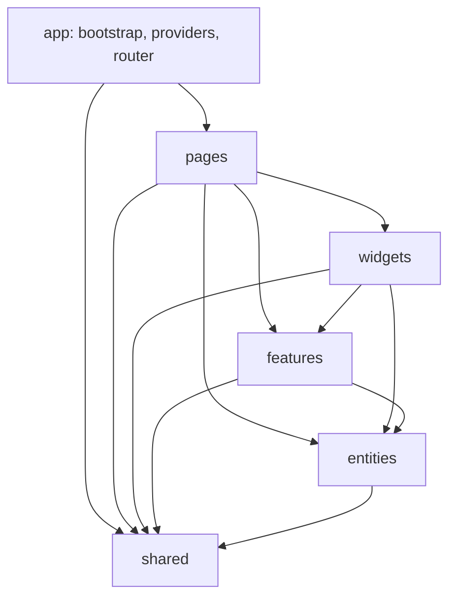

# Vue Lottery App

Vue 3 application organized with Feature-Sliced Design.

## Architecture



The dependency direction is one-way: a layer may depend on lower layers, never
on a higher layer. Cross-slice imports use each slice's `index.ts` public API.

```text
src/
├── app/                  # Bootstrap, providers, router and layouts
├── pages/                # Route-level screens
├── widgets/              # App header/navigation and UsersTable
├── features/             # Authentication and user forms
├── entities/             # Session, users and theme state; API services
└── shared/               # HTTP client, service registry, models and PrimeVue wrappers
```

API services are registered in `app/providers/services.ts` and resolved through
`shared/api/ServiceProvider`. PrimeVue, toast, confirmation services and the
application color preset are installed in `app/providers/ui.ts`. Pages and
widgets use Pinia stores rather than calling services directly. Shared UI
wrappers provide buttons, validated inputs, tables, confirmation dialogs and
toast notifications. The session and theme stores persist their state.

Pinia persistence replaces manual store hydration and subscriptions. The
session store still uses a small custom storage adapter so persisted token
values remain under the legacy `accessToken` and `refreshToken` keys consumed
by the HTTP client; serialization and store synchronization are handled by
`pinia-plugin-persistedstate`. The theme store uses the plugin's default
storage without a custom adapter.

## Development

```sh
npm install
npm run dev
npm run build
npm run lint:fsd
```

Set `VITE_API_URL` in `.env` to configure the API endpoint. See `.env.example`
for the expected variable.
