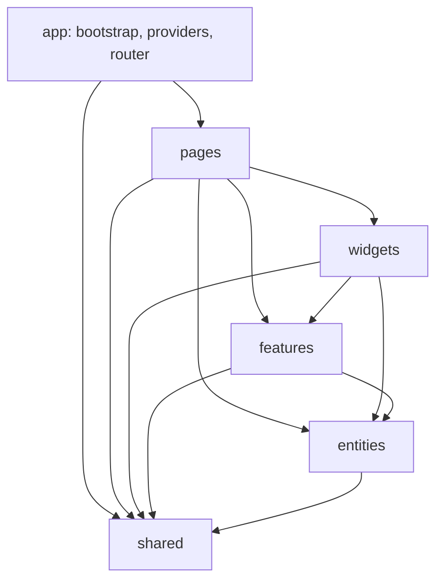

# Vue Lottery App

Vue 3 application organized with Feature-Sliced Design.

## Architecture



The dependency direction is one-way: a layer may depend on lower layers, never
on a higher layer. Cross-slice imports use each slice's `index.ts` public API.

```text
src/
├── app/                  # App bootstrap, service config, router and layouts
├── pages/                # Route-level screens
├── widgets/              # App header/navigation
├── features/             # Authentication and user forms
├── entities/             # Session, users and theme state; API services
└── shared/               # HTTP client, service registry, models and UI wrappers
```

API services are registered in `app/config/services.ts` and resolved through
`shared/api/ServiceProvider`. Pages and widgets use Pinia stores rather than
calling services directly. The session and theme stores persist their state.

## Development

```sh
npm install
npm run dev
npm run build
npm run lint:fsd
```

Set `VITE_API_URL` in `.env` to configure the API endpoint. See `.env.example`
for the expected variable.
